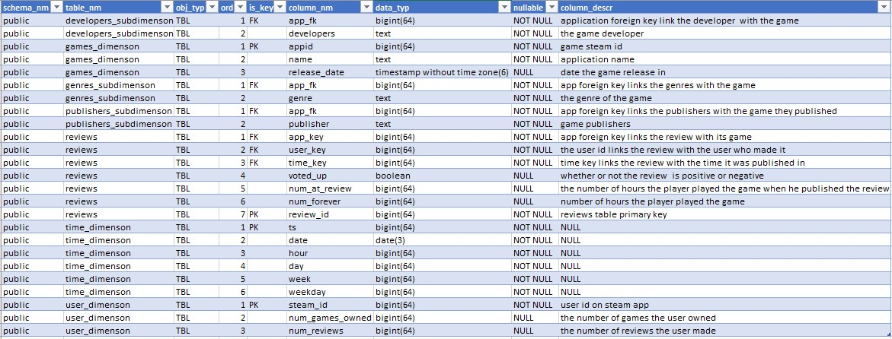
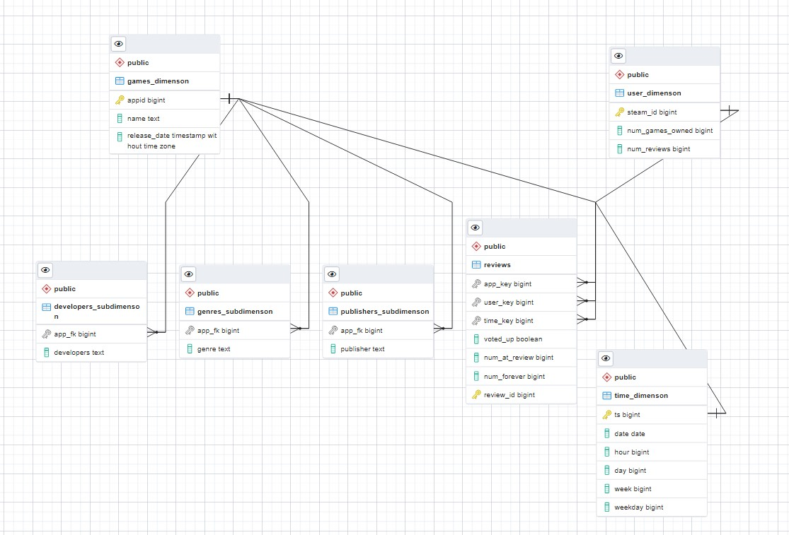
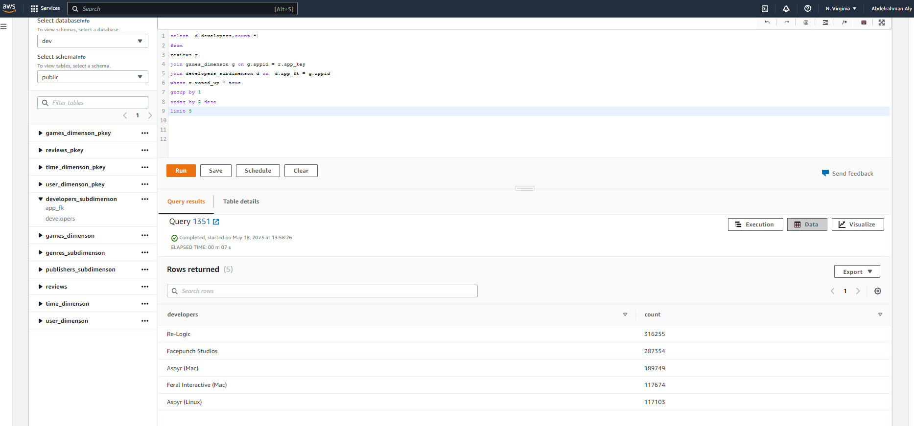

# Steam Reviews Data Lake

This project is designed for people interested in games and data. By using this data lake, we can answer questions such as which games are most liked and most played by genre, publisher, developer, and release date. It also helps us understand how user comments are affected by factors such as the number of games a user owns, hours played, and review frequency.

# Overview

This project combines two public datasets from Steam and builds a scalable data pipeline for analytical use cases. The workflow starts with data ingestion and transformation in Spark, then loads the cleaned data into a Redshift data warehouse for easier querying and analysis.

The project is intended to support analytical questions such as:

- Which games receive the most positive reviews?
- How do review patterns vary by genre, publisher, or developer?
- How do gameplay time and ownership levels relate to user sentiment?

# Datasets

This project is based on two datasets from the Steam ecosystem, both gathered from public sources.

> Note: The review dataset used here was sampled to 2.4 million rows for development. The file format was changed from CSV to Parquet because handling large CSV files created technical issues during processing.

## Steam Reviews Dataset

Source: https://www.kaggle.com/datasets/forgemaster/steam-reviews-dataset

This dataset includes review data for 6 million unique users, 15 million reviews, and 8,183 games.

Each review row contains the following fields:

- steamid - the user's ID
- appid - the ID of the game being reviewed
- voted_up - true means it was a positive recommendation
- votes_up - the number of other users who found the review helpful
- votes_funny - the number of other users who found the review funny
- weighted_vote_score - helpfulness score
- playtime_forever - how many hours the user had played the game at retrieval time
- playtime_at_review - how many hours the user had played the game when writing the review
- num_games_owned - the number of games the user owns
- num_reviews - the number of reviews the user has written
- review - the text of the review
- unix_timestamp_created - the date the review was created (Unix timestamp)
- unix_timestamp_updated - the date the review was last updated (Unix timestamp)

### Dataset summary

- 6,976,390 unique users
- 15,437,471 reviews
- 8,183 games reviewed

## Steam Games Complete Dataset

Source: https://www.kaggle.com/datasets/trolukovich/steam-games-complete-dataset

This dataset contains more than 40,000 games from the Steam store with detailed metadata.

Fields include:

- url - the application page link
- types - product type
- name - the name of the game or application
- desc_snippet - brief game description
- recent_reviews - recent review sentiment (positive to negative)
- all_reviews - overall review sentiment (positive to negative)
- release_date - product release date
- developer - game developers
- publisher - game publishers
- popular_tags - tags associated with the game
- game_details - game details such as multiplayer or single-player
- languages - supported languages
- achievements - the number of achievements
- genre - game genres
- game_description - detailed game description
- mature_content - whether the game contains mature content
- minimum_requirements - minimum device requirements
- recommended_requirements - recommended requirements
- original_price - original price
- discount_price - discounted price at the time the data was scraped

# Data Model

The selected architecture is a Galaxy schema because the data contains multivalued attributes that need to be broken into smaller sub-dimensions. This allows the warehouse to retain more information while keeping the analytical model flexible.

### Data dictionary



### Galaxy schema



# Logical Architecture

The project has two main processes and two main tools. The first is ELT for building the Spark data lake; the second is ETL for moving the processed data into the data warehouse.

- Spark is used for fast data manipulation and easier exploration during development. Not all cleaning and processing is intended to be done in Redshift.
- Redshift is used for easier access by analysts and for smoother integration with downstream applications.

The review dataset contains approximately 15 million records, but only a 2.4 million-row sample was used for development.

### Development steps

- Define the project scope and expected results
- Search for suitable datasets with a common key to connect reviews to game metadata
- Explore the sampled data using Spark to identify technical constraints early
- Define the data model, using the Galaxy schema
- Implement the ELT pipeline and validate it locally
- Create a cloud Spark cluster and replace local variables with cloud-based ones
- Submit the ELT job to the Spark cluster
- Create the Redshift cluster and required tables
- Run the ETL process
- Run data quality checks

### Design considerations

What if the data volume increased by 100x?

- Increase the number of nodes in the cluster, or upgrade the processing power of the existing nodes by moving to a larger instance type such as `ds2.xlarge`.

What if the pipeline needed to run daily at 7:00 AM?

- Use Airflow scheduling and set the DAG schedule to `@daily` with a start time such as `datetime(2023, 5, 18, 7, 0, 0)`.

What if the database needed to support 100+ users?

- Consider using a NoSQL solution or a load-balanced architecture such as Elastic Load Balancing (ELB) to handle large numbers of concurrent requests.

# Execution

To build your own data lake and data warehouse, follow these steps:

1. Upload the required data to S3
2. Create an EMR Spark cluster on AWS
3. Submit the ELT script using Spark:

```bash
./spark-submit elt_spark_submission.py
```

4. Open `dwh.cfg` and update the variables with your credentials
5. Create a Redshift cluster
6. Open the query editor and run the SQL in `create_tables_sql_queries.sql`
7. Run `etl_redshift.py`
8. Run `data_quality_check.py` to verify the files were loaded successfully

# Future Improvements

This project was originally planned to use Airflow to schedule ELT jobs based on year and month variables. However, there were technical challenges integrating Airflow with Spark and submitting jobs to the cluster. Once those issues are resolved, Airflow will be added to automate the pipeline.

# Example Analytics Query

Here is an example of how the data warehouse can be used for analytics:

```sql
SELECT d.developers, COUNT(*)
FROM reviews r
JOIN games_dimension g ON g.appid = r.app_key
JOIN developers_subdimension d ON d.app_fk = g.appid
WHERE r.voted_up = true
GROUP BY 1
ORDER BY 2 DESC
LIMIT 5;
```

_Result:_


